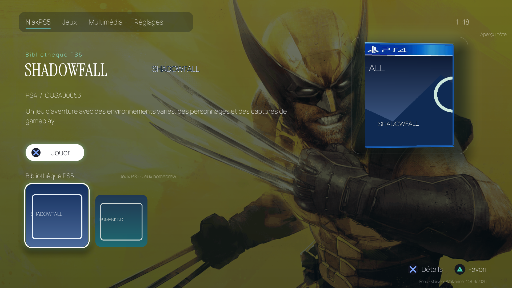

# NiakPS5

**Your library. Your controller. Your PS5.**  
A native home screen for homebrew-enabled PS5 consoles, with an integrated game library, local launching and animated PS4/PS5 3D cases.

[Français](README.md) · [Installation & troubleshooting](native/title/README.md) · [Builds & tests](https://github.com/niakw/NiakPS5/actions)



*Actual OpenGL UI renderer captured under Mesa with sample data. Not a concept illustration and not a direct console screenshot.*

## Made for the console

NiakPS5 gathers title IDs from the local PLDmgr broker, ShadowMountPlus and read-only metadata sources. Navigate with a **DualSense**, switch between **Games** and **Applications**, open game details and select **Play**, without relying on a browser UI.

The animated cases prefer genuine **LaunchBox front/back/spine** scans. Missing faces are reconstructed using distinct compatible assets, with the fixed PS4/PS5 design elements appearing **only** where needed. Other features include daily wallpapers, enriched game artwork, app settings and an experimental system-settings shortcut.

### Verified hardware progress

On the target PS5 13.60 development console, **48 installed title IDs were discovered**, the library became visible and **Play successfully launched a game**. Game/app classification, enriched art, summaries and return-after-game are being refined. A green CI build is **not** evidence that every feature works on PS5 hardware.

## Visual previews

CI publishes [six real OpenGL case angles for PS4 and PS5](https://github.com/niakw/NiakPS5/actions/workflows/native-title.yml). These use QA sample media; no third-party retail scans are redistributed in the public source or release packages.

## Installation / updating

1. Open [GitHub Actions](https://github.com/niakw/NiakPS5/actions/workflows/native-title.yml), select a **successful run on `main`**, and download **`NiakPS5-PPSA99386`**.
2. Extract the archive **once**. Merge its top-level **`data/`** folder at the PS5 FTP root **`/`**. Never delete existing console directories.
3. Open the registered homebrew title **`PPSA99386`**. The archive also includes the companion `niakps5.elf` payload. It does **not** overwrite your PLDmgr configuration, `autoload.txt`, or Sony system files.

A folder copy alone cannot enable a missing autoload entry or fetch private LaunchBox art.

### Refresh covers, screenshots and summaries

From your Mac, use the **bundled** FTP script, with no additional app installed on the PS5:

```bash
python3 data/homebrew/PPSA99386/tools/ftp_install.py --host PS5_IP_ADDRESS --port 2121 --refresh-art
```

It matches current installed-title names to LaunchBox, downloads missing images, validates and tracks cached source images. **Close and reopen NiakPS5** for GPU textures to reload.

```bash
python3 data/homebrew/PPSA99386/tools/ftp_install.py --host PS5_IP_ADDRESS --status
```

Use `--refresh-art --force-art` only to repair artwork that is still wrong. Copyrighted scans stay in the **owner's private console cache**, not in the public repository.

**French descriptions:** LaunchBox text may only be available in English. NiakPS5 retains the original source rather than fabricating a French translation. Optional DeepL integration translates public overview text only:

```bash
export NIAK_DEEPL_API_KEY="YOUR_DEEPL_API_KEY"
python3 data/homebrew/PPSA99386/tools/ftp_install.py --host PS5_IP_ADDRESS --refresh-art --translate-fr
```

The optional translation may consume your DeepL API quota. No private title inventory, profile data or API key is uploaded to this GitHub repository.

## Design commitments

- **Verified library:** live installations are kept distinct from previous FTP snapshots.
- **Authentic covers:** no fake commercial scans and no repeated front image posing as a back screenshot.
- **Responsive UI:** streamed texture work, capped GPU resources and media diagnostics.
- **Console safety:** no `SceShellUI` replacement, PS button hook, disc requirement or licensing bypass.
- **Privacy:** local launching over `127.0.0.1`, no bundled secrets or personal capture collection.

## Building from source

```bash
python3 -m unittest discover -s native/title/tests -p 'test_*.py'
bash native/title/build.sh
```

NiakPS5 is based on a pinned revision of [PS5_VKHomebrewUI](https://github.com/mihawk-99/PS5_VKHomebrewUI), with native OpenGL rendering and reproducible host (Mesa) previews.

**Experimental homebrew software; not affiliated with Sony or LaunchBox.** Trademarks and artwork belong to their respective owners. Source code is **GPL-3.0-or-later**, subject to third-party notices.
